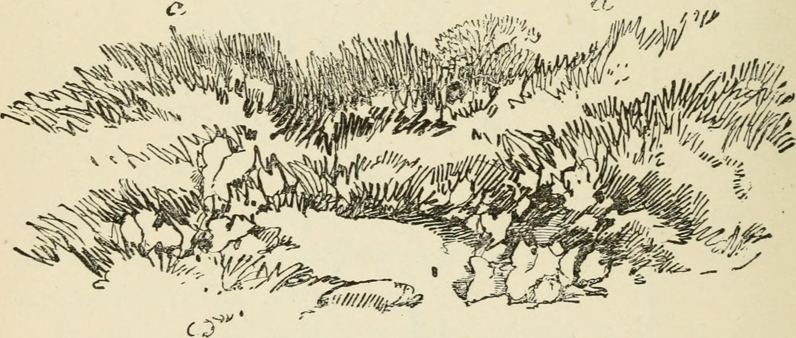
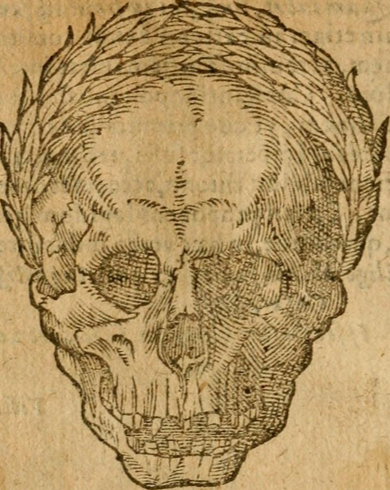
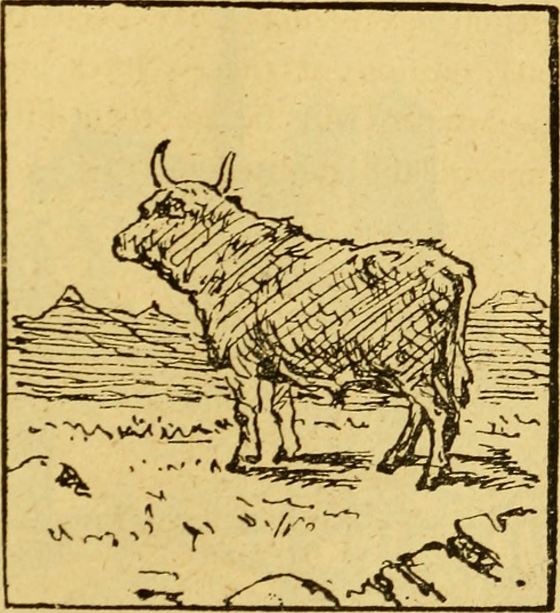

---
tags:
  - rpg
  - rpg/gming
  - rpg/stonetop
title: Stonetop - Session 5 - The Road to Gordin's Delve
description: Taliesyn, Cuno and Wen walk the Makers' Road facing weird encounters and marvelling at excellent engineering and wildlife.
heroImage: ./stonetop-banner.png
pubDate: 2026-11-14
---
Taliesyn, Cuno and Wen walk the Makers' Road facing weird encounters and marvelling at excellent engineering and wildlife.

Recap from previous session [here](/blog/stonetop-session-004-report/).
## Summary

### The Gwead

Taliesyn drives the wagon carrying Winifred and two casks of whisky. So early in spring, it is the only valuable thing they can use for bartering, as everybody has reserves to get through the winter. The precious spirit is made only in Stonetop; they have a special chamber down in The Cistern where they keep the water ready for fermentation. The old cistern seems to do something to the water that gives it a distinct taste, but if there was an explanation for why, it is lost along with the origin of The Stone and many other things from The Makers.

> We decided to swap the cart for a wagon as it made more sense to transport Winifred.

As they leave the old walls beyond the planted fields a 6 metre pristine road lies before them. Since ancient times these roads have stayed functional and safe as it is said no blood has ever stained its solid basalt surface devoid of moss, dirt or dust. As Taliesyn crosses onto the road and goes on he soon feels lighter, and energised. The Mantle is quiet, he does not feel the pressure of them.

On the sides, the gwead grows strong, recovering from the dormancy of winter, although this weed never sleeps and is never fully beaten in the harshest of winters. Cuno looks at the never ending gwead and for a moment his cheery face drops as he remembers his father Pruno.

He was a prominent Stonetop farmer, respected, until he decided to defy the gwead and plant potato crops outside the shelter of the old walls. He drew people across Stonetop in this massive endeavour promising the end of scarcity and an era of prosperity and plenty for all. It was an utter failure that almost caused the village to starve. People didn't take Pruno's suggestions very well from that moment on and that ostracism wasn't just reserved for Cuno's father. Ultimately it drove Cuno to the roads and to seek company in Helior, while his brother Funo worked hard to repair the damage caused by their dad. The brothers drifted apart as their ways of dealing with shame and shunning diverged.

Tesni has never been outside the walls and he is beaming. He asks Cuno if he can go and get some of the grass and he runs and grabs a handful, and brings the weeds and some early flowers to the group. Taliesyn is feeling more open and takes them, examines them.

'Excellent consistency and flexibility, very good. We could make ropes out of this I am sure.' He nods to Tesni, engaging in conversation.

_Gwead - Public Domain Image, more info [here](https://insideoutlibrary.com/p/ia-handbookofdrawin00walk-187-138?q=grass+fields)_
### The Crossroads

To the south on this clear day a shadow stands over The Flats, the old Ruined Tower. As they all look towards it, Cuno, who has been closer to the ruins than anybody else in the past, points out that there are remains of the tower, and pieces of Makers' Road, all over the place. Apparently people go there to find trinkets and treasure but many don't come back. Taliesyn is enticed to have a look on the way back. But for now, Winifred remains the priority. 

> We had a few setup questions about the tower and I filled in some details from _Book 2_ that I read before the game.

The sun sets as they approach The Crossroads, where two roads meet in a cruciform. To the west, there are the mines of Gordin's Delve; to the south, a long road to Marshedge; to the east the way back to Stonetop; and to the north the way to the mountains and Barrier's Pass.

As they get closer the temperature drops and Wen approaches a group of dool trees just at the edge of the road. The trees are bony and their leaves dark and wilt-like. As Wen steps off the road the feeling that they are staring at something unnatural, far away from Danu's domain, chills their spine.

Taliesyn, still in high spirits, proposes to camp in this place for the night as there is more space on the road. But Cuno and Wen are not having it, there is something wrong with this place, they say. Taliesyn gets closer to Wen and walks near the trees, and as soon as he does he can hear The Mantle voices again, asking for souls. He feels the chill too, and notices a small bump ahead, it looks like an old tomb. Then he remembers the stories of the [nosgalau](https://www.splatbook.app/stonetop/reference/31-the-makers-roads--the-nosgalau), stories he heard before he lost his memories. They lure unwary travellers to their doom. Taliesyn concedes. Despite wanting to spend the night here, he reluctantly agrees it might not be the best of ideas, but he makes a mental note to come back and get to the bottom of this mystery.

It is full night when they arrive at their destination, a wayside. Only Cuno is familiar with these spaces and his travels have made him appreciate waysides as a homely, safe haven. This wayside is a blob on the side of the road, blessed with the same properties as the Makers' Road, dotted with carved stones—one of which carries the mark of Helior, crafted by Cuno on a previous journey. There are also a firepit and a well in the circle and at the centre there is an obelisk marked with a single rune.

> I missed that the obelisk was part of the waysides so I am adding it now to the report and will discuss with my players before or during the next game.
> 
> If you are a player reading this please remind me!

While the group cooks and settles for the night Wen sneaks out just outside the protection of the roads. And as they step out in the cold, they can hear the voices of the Forest Folk moving like the rustling of leaves in autumn. Wen tries to concentrate, sits and communes with the place, palms in the earth.

The voices are clearer now, closer, and ask Wen to lead them to freedom, to come and help them. Wen feels it, this is no Forest Folk place, it is all a masquerade; so as they move into a trance and see the masked figures in their dreamlike state Wen grabs one by the neck and shakes it. The mask vanishes revealing a wispy skull, showing hungry blackened teeth and ringing with the sound of a dry raspy laugh. No welcoming spirits around here, just the nosgalau.

'What are you doing here?' Wen's voice echoes.

'Come with us and we'll show it, yes, leave those cold roads and come into the night,' the voices respond in echoes, the cadaverous one wrestling against Wen's grip with no success, other ones floating around.

'And where would you take me?'

'Oh to the tower, yes, precious one, no cold there, just quiet and the warmth of the earth.'

'Do not get close to me or any of my group or you will regret it.' Wen grabs the face and squashes the smoke as it disappears with the trance fading. Brother and Sister circle around Wen snarling in a hum and come back to them.

> This was triggered by the _[Spirit Tongue](https://www.splatbook.app/stonetop/reference/playbooks-the-blessed--spirit-tongue)_ move from _The Blessed_. Wen rolled for _[Defy Danger](https://www.splatbook.app/stonetop/reference/06-player-moves--defy-danger)_ as the nosgalau are hostile and they scored 10+, which means Wen manages to keep the nosgalau away from the group.

_A nosgalau - Public Domain image, more info [here](https://insideoutlibrary.com/p/ia-symbolaheroicamc00para-271-187?q=spirits+skull)_

At camp Taliesyn tends Winifred, who murmurs in a febrile state. 'I'm here', 'Radko', 'Don't take me!' are some of the fragments he catches. Radko, he thinks; and he is transported back to that cave many years ago, where he is standing next to a white robed man who shouts Radko's name, demanding something. Again, he leaves as the stabbing starts and runs with _The Mantle_ and _The Azure Hand_, shame and fear shaking his body.

Wen walks back into the camp, and Tesni's apprehension dissipates. When he realised Wen was not with them he urged Cuno and Taliesyn to do something. Cuno tried to appease him by pointing out that Wen knows how to be ok on their own, and has got Brother and Sister at their side. That didn't quite convince the youngling. 

They all have some potato stew together by the fire, and after eating Cuno entertains the group with a song about Gordin, the founder of [Gordin's Delve](https://www.splatbook.app/stonetop/reference/22-gordin-s-delve--defenses-1). It is the story of how the hero came to be, his falling into a pond of clear water and how instead of being pulled down by the Things Below he was gifted with a vision of a powerful weapon hidden in the mountains. Cuno sings how a group of travellers guided by him reached the doors of the Delve and established a town there, where they dug. And _The Lightbearer_ closes with Gordin's end in a cave-in, without having found the weapon he was destined to wield, but having founded a town that was now leaderless.

> We take advantage of this moment by the fire to do more worldbuilding and come up with:
>   - Gordin was from Marshedge. He fell in a pond of clear water and had a dream of a powerful weapon in the mountain. He found the entrance into the mountain and the town was built up around his find
>   - He "died" in a cave-in
>   - The merchant Yanz comes most regularly from Gordin's Delve to Stonetop. I have decided to leave this out of the report but it might become relevant in the next session

### A herd of aurochs

Next morning the wind whistles through The Flats in gusts of piercing cold. The group breaks camp early and they walk for a few hours, sore muscles from sleeping on a hard surface. A few hours later they are covered by a mantle of light rain.

Then they notice something on the horizon. A cloud of dust and mud, getting bigger and closer every moment. Aurochs heading their way, stampeding their way and trampling the gwead that no doubt will grow stronger tomorrow.

'Cuno, give me one of your fiddle strings, quick,' Taliesyn urges his companion.

He ties a small knife to one end to create some weight, and waves it in circles. The wind helps create noise and The Tinkerer hopes this will be enough to divert the panicked horde. As they get closer they get a glimpse of the pursuer. It is a big creature of black and yellow plumage, and a storm seems to gather around them; 'A Thunder Drake!' shouts Tesni excited and pointing with his finger, quickly lowering his hand when it starts to tremble.

> This is a clever use of [Work with what you've got](https://www.splatbook.app/stonetop/reference/playbooks-the-seeker--work-with-what-you-ve-got), a _Seeker_ move.

Taliesyn's trick works and as the aurochs cross to the other side of the road, the Thunder Drake desists from their pursuit. As the aurochs pass Wen runs towards one of them, lassoes him, and hops on his back. _The Blessed_ disappears with the aurochs, Brother and Sister trailing behind, silence follows.

A while later Wen comes back riding the aurochs, looking tired and trying not to get thrown and stomped on. They keep moving towards Gordin's Delve.

> Here Wen rolled _[Defy Danger](https://www.splatbook.app/stonetop/reference/06-player-moves--defy-danger)_ again and in exchange for being able to ride this aurochs they mark a debility (weakened) as they will need to tire the creature out and try to create a bond.

_Aurochs - Public Domain image, more info [here](https://insideoutlibrary.com/p/ia-illustratednotes00lark-46-64?q=auroch)_.

It takes the whole day, and a careful night of shifts with Cuno, to settle the creature, Tor The Aurochs. While Wen sleeps Cuno uses one of his candles to light a consecrated flame and soothes Tor, making him focus on the light. Tesni is keen to learn more about Helior's magic and observes the process, asking Cuno to share how he is able to do it. _The Lightbearer_ responds as cryptically and enigmatically as always. 

> Here Cuno used [Moth to a Flame](https://www.splatbook.app/stonetop/reference/playbooks-inserts--moth-to-a-flame), one of the invocations available to _The Lightbearer_.

The next day they march on. On the slope of the bare mountain smoke rises. There are no trees around, just mud and rock, they have finally arrived at Gordin's Delve.

## Game thoughts

We are back on track and this session's pace felt more in line with what most of the sessions have been. We were all happy going back to that feeling and exploring travel more in depth. Getting to define a few more elements about the world kept everybody engaged. 

And we also got a couple of great scenes! I wasn't expecting Wen to risk it and hop onto an aurochs but it was great! And now they've got a follower and lots of possibilities open when they get back to Stonetop!

One of the things that is still on my mind about improvements is NPC characterisation. As part of the wrap up at the end of the session, that was the piece of feedback that I would like to work on as the campaign progresses. In this session I tried to portray Tesni as enthusiastic, in awe, and willing to help because he is trying to prove himself, but there is still a feeling that something distinct is missing there.